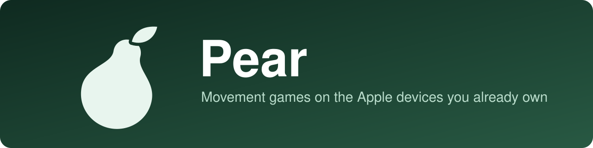
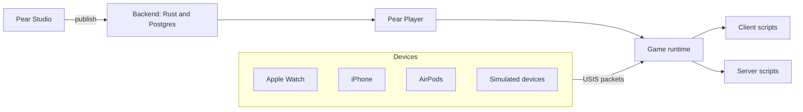

<div align="center">



**Pair your peripherals to play with peers.** Build and play movement-based games using iPhones, Apple Watches and AirPods as spatial inputs, with no dedicated tracking hardware.

[Apps](#apps) · [How it works](#how-it-works) · [Quickstart](#quickstart) · [Repo layout](#repo-layout) · [What's next](#whats-next)


Built for HackPrinceton (Entertainment track).

</div>

<!-- TODO: add Studio / Player / Companion screenshots to docs/assets/ and embed them here (needs a Mac with Xcode and devices) -->

## Apps

| App | What it is | Where |
|---|---|---|
| **Pear Studio** | Build and test games without owning every device: 3D device simulator, client and server scripts, local multi-player test sessions, plugins (incl. LangChain Deep Agents). Browser, Tauri desktop and native macOS. | `Web/studio`, `Apps/PearStudio` |
| **Pear Companion** | iPhone and Apple Watch app streaming motion, touch, heart rate and wrist gestures into games. | `Apps/PearCompanion` |
| **Pear Player** | iPhone, iPad and Mac app: sign in with Apple, browse published games, add friends, join over the network. | `Apps/PearPlayer` |

## How it works



- **One input format.** Real and simulated devices both produce USIS, a versioned JSON packet format (`Schema/`).
- **Scripting.** Client scripts run in JavaScriptCore or the web runtime; server scripts run in an embedded JS engine (rquickjs) on the game server.
- **Backend** (`Backend/`): Rust, Axum, SQLx on PostgreSQL. Accounts, project storage, publishing, discovery, plugin marketplace, game servers.
- **Infrastructure**: Vultr compute, Postgres and Object Storage (`Deploy/`). Only game content goes to the cloud; live sensor data stays on the local network.

## Quickstart

```bash
# Web Studio
cd Web && npm install && npm run dev

# Tests
cd Web && npm test

# Backend (needs Postgres; see Deploy/ for compose and env)
cd Backend && cargo run
```

Swift apps open from `Pear.xcworkspace` in Xcode on macOS.

## Repo layout

```
Apps/       Studio, Player, Companion (Swift)
Packages/   shared Swift packages (PearCore, PearInput, PearRuntime, ...)
Web/        web Studio and runtime packages
Backend/    Rust server
Plugins/    plugins, incl. langchain-deepagents
Games/      QuickDraw, Manhunt
Schema/     USIS packet schema
Deploy/     Docker, Caddy, Vultr scripts
docs/       docs and brand kit
```

## What's next

- Vision Pro, iPad/Pencil input and third-party Bluetooth controllers.
- Deeper Deep Agents support for creating, debugging and optimizing games.
- Plugin ecosystem, community publishing, moderation and project version history.

## License

<!-- TODO: no LICENSE file in the repo yet -->
